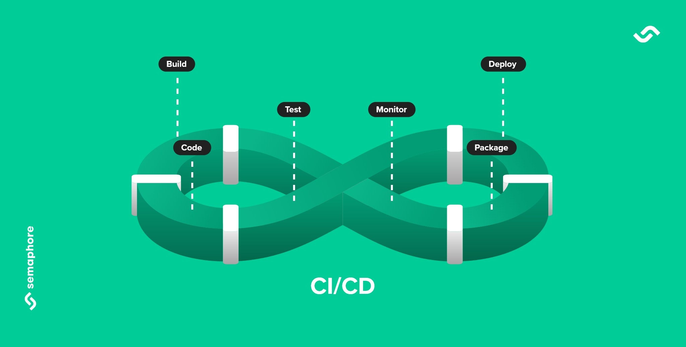

# CI/CD

- **CI/CD** stands for Continuous Integration and Continuous Delivery/Deployment, a DevOps practice that automates the process of building, testing, and delivering code changes to ensure faster and more reliable software releases

### Continuous Integration (CI)

- **What it is**: A practice where developers frequently merge their code changes into a central repository
- **How it works**: Automated processes then detect issues, build the application, and run automated tests against the new code
- **Why it's important**: It helps catch bugs early, reduces integration challenges, and provides rapid feedback to developers

### Continuous Delivery (CD)

- **What it is**: An extension of continuous integration where code changes are automatically built, tested, and prepared for release to a production or testing environment after the build stage
- **How it works**: The process continues from CI, automatically deploying code to environments ready for use, but often still requires a manual step to release to end-users
- **Why it's important**: It ensures that code is always in a deployable state, enabling more frequent and reliable releases

### Continuous Deployment (CD)

- **What it is**: A further extension of Continuous Delivery
- **How it works**: Every code change that passes the automated build and test stages is automatically deployed directly to the production environment without manual intervention
- **Why it's important**: It maximizes the speed and efficiency of software releases, getting new features and fixes to customers as quickly as possible

---

### Benefits of CI/CD

- **Faster Development Cycle**: Streamlines the software development lifecycle
- **Improved Code Quality**: Catches bugs early through automated testing
- **Reduced Costs**: Automates manual processes, lowering labor costs and minimizing errors
- **Increased Visibility**: Provides a clear view of the software delivery process
- **Rapid Feedback**: Enables a quick feedback loop between developers and clients

---

## Why use CI/CD for Data Pipelines?

- **CI/CD** for data pipelines adapts traditional software development practices to automate the building, testing, and deployment of data workflows
- This approach ensures data reliability, accelerates development cycles, and improves collaboration among data teams.

### CI/CD Pipeline Stages for Data

A data pipeline CI/CD typically follows these automated stages:
- **Source**: Developers commit data pipeline code (e.g., SQL scripts, Python notebooks, etc) to a version control system like `Git`
- **Build**: The continuous integration server (e.g., Jenkins, GitHub Actions, GitLab CI) detects the change, compiles the code (if necessary), manages dependencies, and packages the artifacts (e.g., Docker images)
- **Test**: Automated tests run on the built artifact using small, representative, or synthetic data samples. This includes unit tests, integration tests, and critical data quality checks
- **Deploy**: Upon successful testing, the pipeline automatically deploys the changes to a staging or production environment
- **Monitor & Feedback**: Post-deployment, the running pipeline is monitored for performance, data quality anomalies, and errors. Feedback loops alert the team to issues, enabling quick fixes and continuous improvement

### Key tools for implementing CI/CD

- **Version Control**: Git, integrated with platforms like GitHub, GitLab, and Azure DevOps
- **CI/CD Automation**: Jenkins, GitHub Actions, GitLab CI, and CircleCI
- **Orchestration**: Tools like Apache Airflow, Dagster, and Prefect to manage and monitor data workflows
- **Infrastructure as Code (IaC)**: Terraform or cloud-native tools like AWS CloudFormation to manage environments
- **Data Platforms**: Solutions like Databricks and Snowflake offer integrated CI/CD capabilities to manage data assets and pipelines
- **Testing Frameworks**: Tools for data quality checks, schema validation, and unit testing