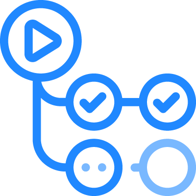
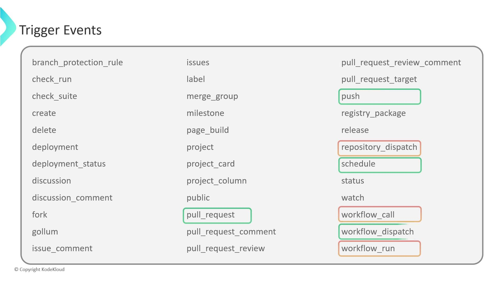
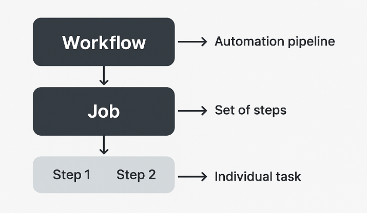
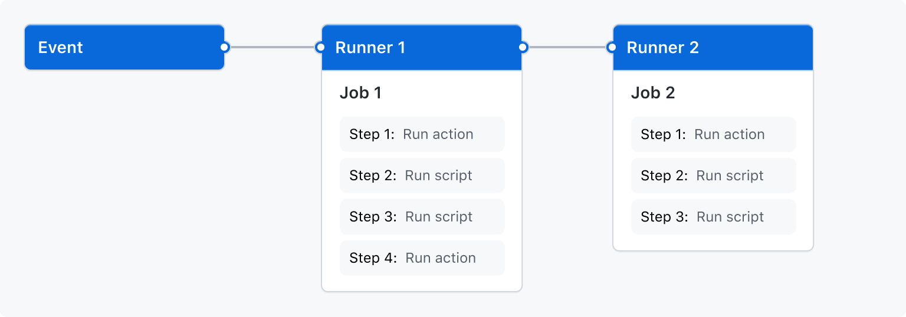
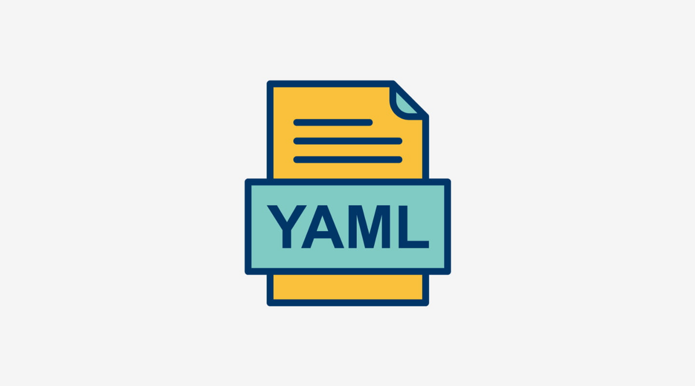
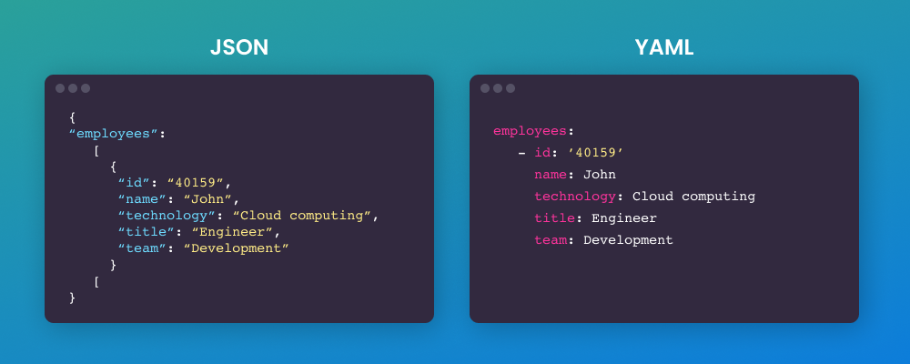
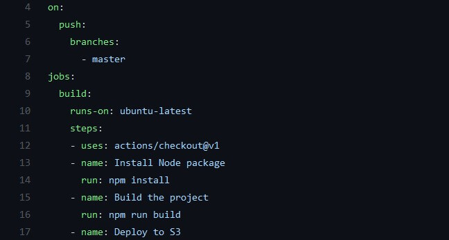

# GitHub Actions

- **GitHub Actions** is a continuous integration and continuous delivery (*CI/CD*) platform that allows you to automate your build, test, and deployment pipeline
- You can create workflows that build and test every pull request to your repository, or deploy merged pull requests to production
- Think of it as your robot assistant that watches your repo and performs tasks for you whenever something changes

---

### How it works

- You can configure a **GitHub Actions** workflow to be triggered when an event occurs in your repository, such as a `pull request` being opened or an `issue` being created
- A workflow is a configurable automated process that will run one or more jobs
- Workflows are defined by a `YAML` file checked in to your repository and will run when triggered by an event in your repository, or they can be triggered manually, or at a defined schedule
- Workflows are defined in the `.github/workflows` directory, in a `ci.yml` file
- The file tells *GitHub* what to do (for example: install dependencies, run tests, or deploy)
- *GitHub* then spins up a virtual machine (runner) to execute those steps automatically

---

### Events

- An event is a specific activity in a repository that triggers a workflow run
- **GitHub Actions** can run workflows based on different events, such as:
    - `push`: when you push code to *GitHub*
    - `pull_request`: when someone opens a pull request
    - `schedule`: on a timer (like every 2 hours)
    - `workflow_dispatch`: when you trigger it manually

---

### Jobs

- A job is a set of steps in a workflow that is executed on the same runner
- Each step is either a shell script that will be executed, or an action that will be run
- Steps are executed in order and are dependent on each other

---

### Runners

- A runner is a server that runs your workflows when they're triggered
- Each runner can run a single job at a time
- **GitHub** provides Ubuntu Linux, Microsoft Windows, and macOS runners to run your workflows
- Each workflow run executes in a fresh, newly-provisioned virtual machine

---

## What is a `yaml` file?

- YML or YAML stands for:
    - Originally - **Y**et **A**nother **M**arkup **L**anguage
    - Now - **YAML** **A**in't **M**arkup **L**anguage
- A **YAML** file — which uses the `.yml` or `.yaml` extension — is a human-readable text file used for configuration
- It’s a way to describe settings or instructions in a structured, easy-to-read format

---

### What makes YAML special

- It uses indentation (spaces) instead of curly braces `{}` or brackets `[]`
- It’s clean and easy to understand — perfect for configuration files
- It stores data as key-value pairs

---

### Why we use it in this instance

 

In our DataOps project, we use YAML because:
- GitHub Actions uses **YAML** to define workflows
- It tells GitHub what events trigger the workflow (`on:`)
    - what jobs to run (`jobs:`)
    - what steps to perform (`steps:`)
- YAML makes it easy for GitHub to read and execute your automation instructions
> **In short**: The `.yml` file is the configuration script that tells **GitHub Actions** what to do and when to do it — like an instruction manual written in plain English for automation