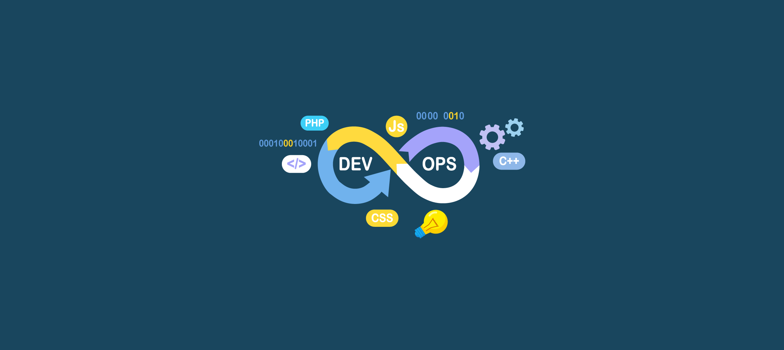
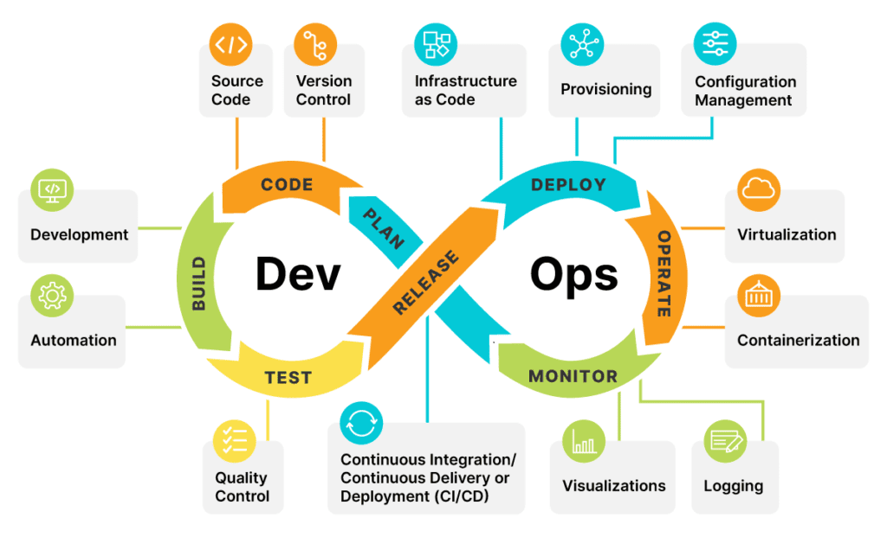
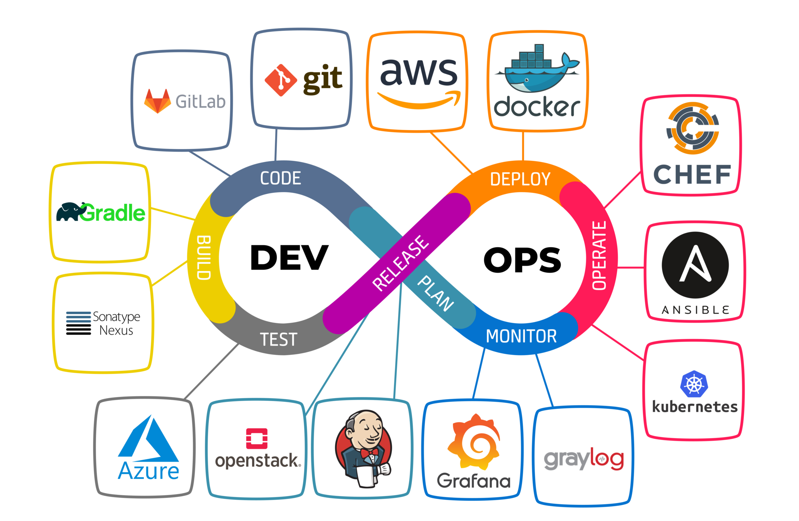
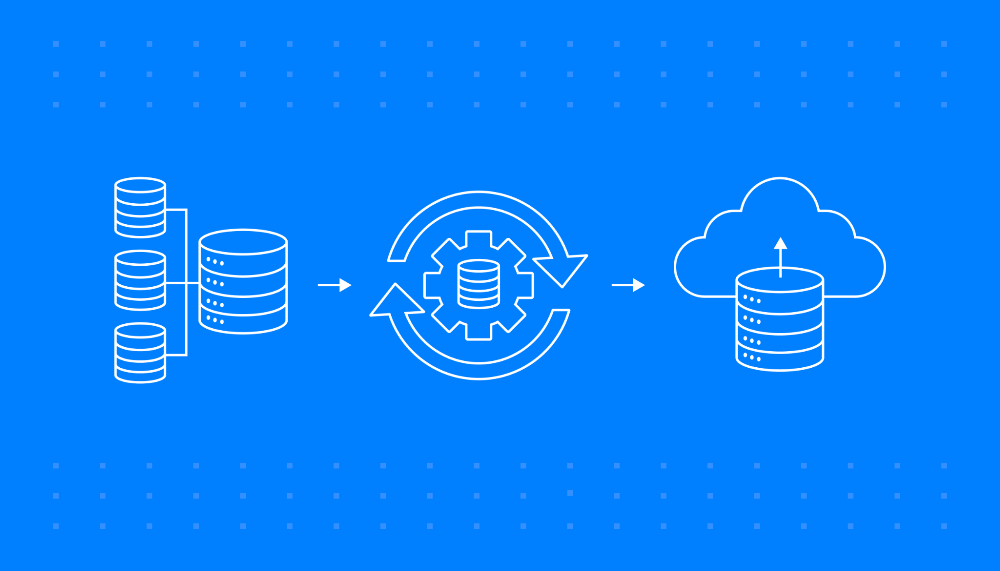
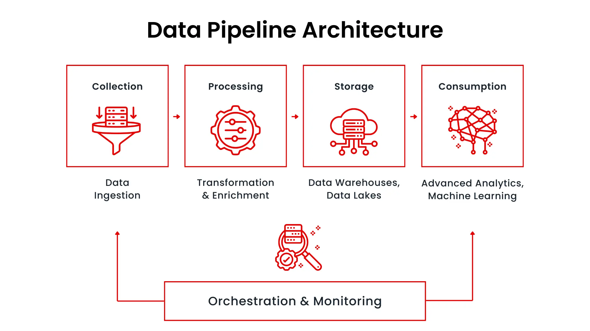
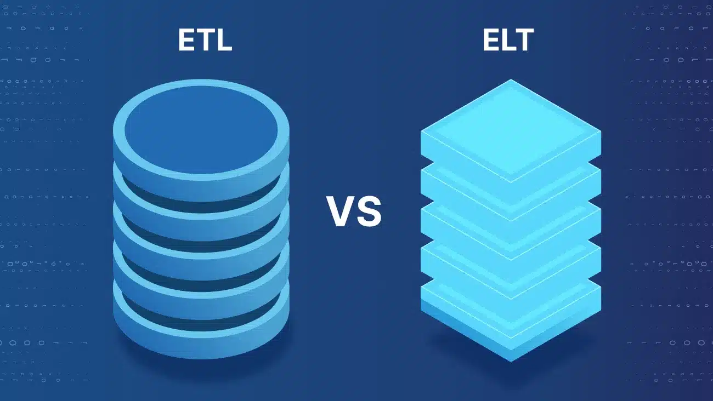
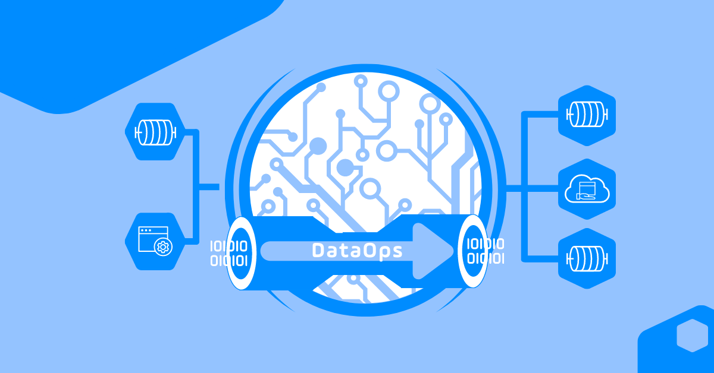
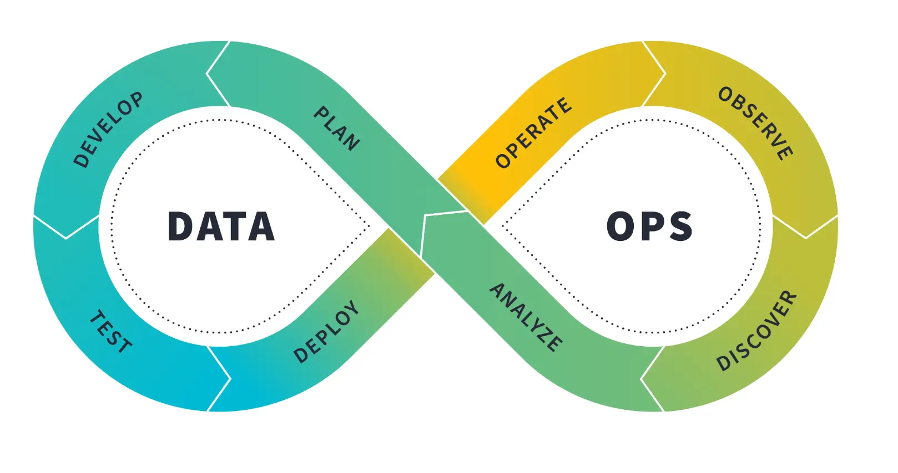

# DevOps & Data Pipelines

---

## What is DevOps?

- **DevOps** is a cultural philosophy, a set of practices, and a collection of tools that automate and integrate the processes between software development (Dev) and IT operations (Ops) teams to increase the speed, efficiency, and quality of software delivery
- It breaks down traditional silos between these departments, fostering collaboration and communication to enable faster innovation, more reliable applications, and a competitive advantage through a more agile software development lifecycle

### Key Components of DevOps

- **Cultural Philosophy**: Emphasizes teamwork, shared responsibility, and continuous improvement across development and operations
- **Practices**: Utilizes methodologies like continuous integration and continuous delivery (*CI/CD*), automated testing, infrastructure as code (*IaC*), and continuous monitoring
    - Infrastructure as Code (*IaC*) means describing your servers and cloud setup with code so computers can build it automatically
- **Tools**: Employs a variety of automation tools for building, testing, deploying, and managing applications and infrastructure

### Why DevOps Matters

- **Faster Delivery**: Automating processes and enabling continuous development leads to quicker releases of software
- **Improved Quality & Stability**: Automated testing and infrastructure management ensure applications are more reliable and stable
- **Enhanced Collaboration**: Bridges the gap between development and operations, allowing teams to work together more effectively
- **Increased Agility**: Allows organizations to respond to business needs and market changes more quickly
- **Better Security**: Integrates security measures into the development pipeline from the start, rather than treating it as an afterthought

 

### The DevOps Lifecycle

DevOps operates as a continuous loop, including the following phases:
1. **Plan**: The conceptualization and planning of new features or applications
2. **Code**: Developers write and collaborate on code, often in small, iterative increments
3. **Build**: Code is compiled and prepared into deployable artifacts
4. **Test**: Automated tests are performed to ensure the quality and stability of the code
5. **Release**: The validated code is prepared for deployment
6. **Deploy**: The application is deployed to various environments
7. **Operate & Monitor**: The application is run and monitored in production to ensure performance and availability
8. **Feedback**: Insights from monitoring and user feedback are fed back into the planning phase to drive further development

### Categories of DevOps Tools

- **Version Control**: Tools like `Git` that track code changes, facilitate collaboration, and allow for easy code review
- **Continuous Integration/Continuous Delivery (CI/CD)**: Tools such as `Jenkins`, `GitHub Actions`, or `GitLab CI/CD` that automate code building, testing, and deployment
- **Containerization**: Tools like `Docker` that package applications and their dependencies into portable containers
- **Container Orchestration**: Platforms like `Kubernetes` that manage the deployment, scaling, and operation of containerized applications
- **Infrastructure as Code (IaC)**: Tools like `Terraform` or `AWS CloudFormation` that allow teams to provision and manage infrastructure through code
- **Configuration Management**: Tools such as `Ansible`, `Chef`, or `Puppet` to automate the management of server configurations
- **Observability & Monitoring**: Tools like `Prometheus` or `Datadog` that provide insights into system health and performance
- **Security**: Integrated security tools (`DevSecOps`) that perform automated security testing and vulnerability scanning throughout the pipeline

- **DevOps** helps developers and operations teams work together to build, test, and release software faster, more reliably, and with fewer mistakes

---

## What is Data Pipeline?

- A data pipeline is an automated series of steps that collect, process, and move raw data from its source(s) to a destination, such as a data warehouse or analytics database
- Key steps include ingestion (collecting data), transformation (cleaning and structuring), and loading (storing the data)
- Data pipelines are crucial for making data usable, automating repetitive tasks, and enabling data analysis, machine learning, and business intelligence by transforming raw information into a consistent, reliable format

### Key Stages & Concepts

- **Ingestion**: Data is collected from various sources and ingested into the pipeline. This can include structured and unstructured data from databases, logs, APIs, and other sources
- **Processing**: The ingested data undergoes processing, which may involve transformation, cleansing, aggregation, and other operations to prepare it for analysis or storage
- **Storage**: Processed data is stored in a suitable data store, such as a database, data warehouse, or cloud storage, depending on the requirements of the organization
- **Analysis**: Analytical tools and algorithms are applied to the stored data to extract meaningful insights, patterns, and trends
- **Visualization**: The results of the analysis are presented in a visual format through dashboards or reports, making it easier for stakeholders to interpret and act upon the information

### Data Pipeline Architecture

- Data pipeline architecture is the process of designing how data is collected, processed, and transferred from different sources to destinations for analysis or storage

### Purpose and Benefits

- The purposes and benefits of having a data pipeline is:
    - **Automation**: Eliminates manual data handling, saving time and reducing errors
    - **Data Quality**: Ensures data is clean, consistent, and in the right format for analysis
    - **Accessibility**: Provides a reliable, centralized source of data for various business needs
    - **Scalability**: Designed to handle large volumes of data, supporting business growth
    - **Actionable Insights**: Makes data available quickly and reliably, accelerating decision-making

 

### ETL vs ELT

- **ETL** and **ELT** are two common approaches in data integration
- Their main task is to transfer data from one place to another
- However, each has unique characteristics and is suitable for different data needs

### ETL

- **Extract**: Data is pulled from source systems
- **Transform**: Data is transformed and cleaned in a separate, intermediate staging area before being loaded
- **Load**: The transformed data is then loaded into the target data warehouse or data system for analysis
- **Best for**: Smaller datasets, situations requiring high data security, and complex transformations where data needs to be structured and clean before it enters the warehouse

### ELT

- **Extract**: Raw data is pulled directly from source systems
- **Load**: The raw data is loaded into the target system (e.g., a cloud data warehouse) without immediate transformation
- **Transform**: Data is transformed as needed using the target system's processing power after it's already loaded
- **Best for**: Large, diverse datasets, modern cloud environments with powerful processing capabilities, and scenarios where timely ingestion of all data is prioritized, with transformations performed later as required

---

## DevOps + Data Pipelines = DataOps

- **DataOps** is a collaborative, agile practice for managing data that applies **DevOps** principles to improve data analytics, focusing on automation, continuous improvement, and collaboration between data engineers, analysts, and other data consumers to deliver high-quality data and analytics faster and more reliably
- It automates data pipelines, ensures data quality and governance, and breaks down silos between data teams and business users to provide timely, valuable insights for decision-making

### Key Principles and Goals

- **Agile Methodology**: Employs Agile principles to enable rapid iteration and continuous improvement in data processes
- **DevOps Principles**: Borrows the automation, collaboration, and integration practices from DevOps to manage the entire data lifecycle
- **Automation**: Automates various aspects of the data delivery pipeline, from data ingestion and transformation to deployment and monitoring
- **Collaboration**: Fosters teamwork and communication between data creators and consumers to align on data needs and ensure data is fit for purpose
- **Quality and Reliability**: Focuses on improving the accuracy and consistency of data through standardized validation rules and continuous testing
- **Speed and Efficiency**: Aims to accelerate the time to insight and the delivery of analytics, providing value to the business more quickly
- **Governance**: Integrates robust data governance, security, and lifecycle management into automated data flows

### Why is DataOps important?

- Manual data management tasks are time-consuming and business needs are always evolving
- A streamlined approach to the entire data management process, from collection to delivery, ensures an organization is agile enough to handle challenging multi-step initiatives. It also allows data teams to manage explosive data growth while they develop data products
- The goal is straightforward yet transformative
- Deliver reliable, high-quality data to decision makers exactly when they need it. This means no more quarterly release cycles for urgent requests, no more data quality surprises during board presentations, and no more blame games when pipelines break
- DataOps creates a smooth, predictable flow from raw data to actionable insights, with everyone aligned on making that happen

### The DataOps Lifecycle

- To facilitate faster and more reliable insight from data, **DataOps** teams apply a continuous feedback loop, also referred to as the *DataOps lifecycle*
- The DataOps lifecycle takes inspiration from the DevOps lifecycle, but incorporates different technologies and processes given the ever-changing nature of data
- The DataOps lifecycle allows both data teams and business stakeholders to work together in tandem to deliver more reliable data and analytics to the organization
- This cycle will repeat itself over and over again
- By applying similar principles of DevOps to data pipelines, data teams can better collaborate to identify, resolve, and even prevent data quality issues from occurring in the first place