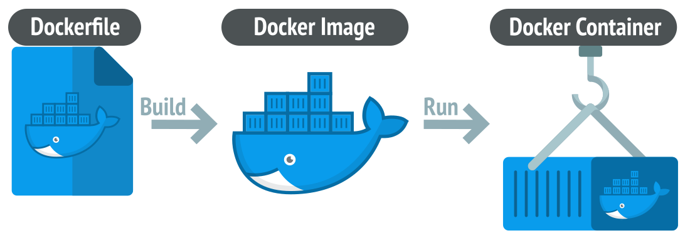
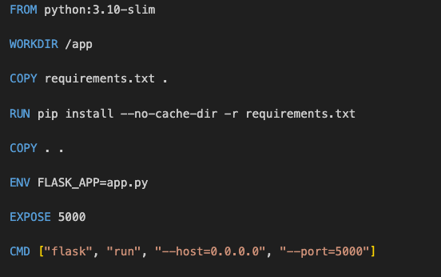

# What is Docker?

- **Docker** is a software platform that allows you to build, test, and deploy applications quickly
- It packages software into standardized containers

---

It starts with:
- A **Dockerfile** that is like a recipe that tells *Docker* how to build a image
- A **Docker image** is like a blueprint or template for a container
- **Docker** packages software into standardized units called *images* that have everything the software needs to run including libraries, system tools, code, and runtime
- An *image* is like a tiny, lightweight box where your app lives, when you run the *image* it becomes a *container*, and the app will be up and running
- **Containers** make sure your app runs exactly the same no matter where you start it — on your laptop, on your friend’s laptop, or on a cloud server
- **Docker** was created to simplify software distribution and installation

---

## Think of if as:

| Term | What it is | Analogy |
| --- | ---- | ----| 
| Dockerfile | Instructions | Recipe |
| Image | Built package (ready to run) | Baked cake |
| Container | Running instance | Eating the cake |

---

### Why Docker Is Essential

- Think of **Docker** as a “box” that contains everything your app needs to run — your code, `Node.js`/`Python`, libraries, configurations, and environment settings
- When you share this box with someone else, they can run your app exactly the same way you do, no matter what computer or operating system they’re using
- Without **Docker**, your app might work perfectly on your own machine but fail on someone else’s laptop or a cloud server due to differences in `Node.js` versions, missing packages, misconfigured environment variables, or OS-specific file paths — the classic “It works on my machine” problem

---

## What Docker Fixes

- **Consistency** → Docker makes sure your app behaves exactly the same everywhere — in testing, CI/CD, or production
- **Portability** → You can run your pipeline on your laptop, GitHub Actions, or Render — all from the same image
- **Automation** → CI/CD systems can automatically build and deploy Docker images without worrying about setup
- **Clean environment** → Each container is isolated — no messy dependencies or version conflicts
- **Easy recovery** → If something breaks, you can rebuild the same image again and it’ll work identically
- **Scalability** → means you can easily run more copies of your app when more people use it, and fewer copies when demand is lower
- In DataOps we need all of that
- Docker makes your DataOps pipeline reliable, portable, and consistent — so you can focus on improving data quality, not fixing broken environments

---

## What a Dockerfile Is

- A Dockerfile is like a recipe that tells Docker how to build your image
- It has all the steps Docker needs to follow to create the “box” (image) that contains your code and its environment

---

## Dockerfile

Each line in the Dockerfile gives Docker a specific instruction:
- `FROM` → start from a base image
- `WORKDIR` → Set the working directory inside the image
- `COPY` → Copy files into the image
- `RUN` → Execute actions inside your image, like installing dependencies
- `ENV` → set environment variables
- `EXPOSE` → tell Docker which port to open
- `CMD` → Tell Docker what command to run when the container starts

---

## How to use Docker

- `docker build` - to package your app and its environment into a portable image
- `docker run` - to start a running container from that image so the app can actually work

---

## Why It Matters for DataOps

In DataOps, repeatability is key. The Dockerfile ensures:
- Every build is identical
- The setup process is automated
- CI/CD pipelines can easily rebuild and deploy the same environment
> A Dockerfile is a step-by-step recipe that tells Docker how to build and run your DataOps pipeline the same way everywhere — reliably, automatically, and without setup headaches